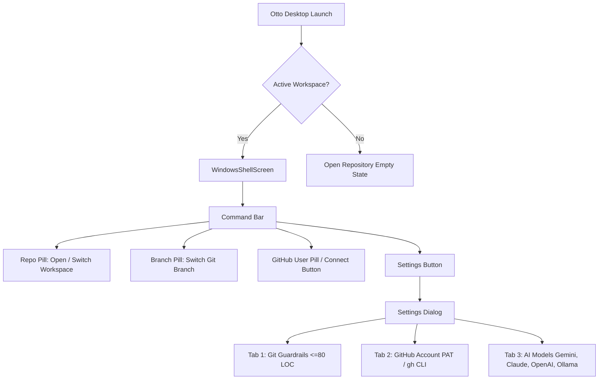

# Architectural Specification: Direct GitHub & LLM Integration (VS Code Model)

## 1. Overview & Context

Otto is transitioning to the **VS Code / GitHub Desktop architecture standard**:
- **No Mandatory Login Gate**: Otto boots directly into the workspace interface, eliminating web login redirect friction and expired credential failures.
- **Direct GitHub Account Management**: Connect via GitHub Personal Access Token (PAT) or automatic detection from GitHub CLI (`gh auth token`), with real-time validation against `https://api.github.com/user`.
- **Direct LLM & Coding Agent Management**: User-configurable API keys and base URLs for Google Gemini, Anthropic Claude, OpenAI, and local Ollama (`http://localhost:11434`), plus agent bridge toggles.
- **Repository-First Workspace Flow**: Automatically opens the current git repository (or last active repository) with a clean "Open Repository" folder picker.
- **Clean Empty States & Zero Mock Data**: In-memory and persisted state contains only genuine repository commits and connected agent profiles.

---

## 2. Component Architecture

---

## 3. Data Flow & Security Guardrails

1. **GitHub Credentials**:
   - Token stored in local secure storage / encrypted daemon config.
   - Scopes required: `repo`, `read:user`.
   - Zero hardcoded demo credentials.

2. **LLM Provider Keys**:
   - Persisted via `POST /api/llm/configure`.
   - Keys masked in UI responses (`sk-...1234`).
   - Zero secondary token markup or hidden platform fees ($0 extra fee guarantee).

3. **Workspace Management**:
   - `POST /api/workspace/open` verifies git root and reloads branches, commits, and diff hunks dynamically.
